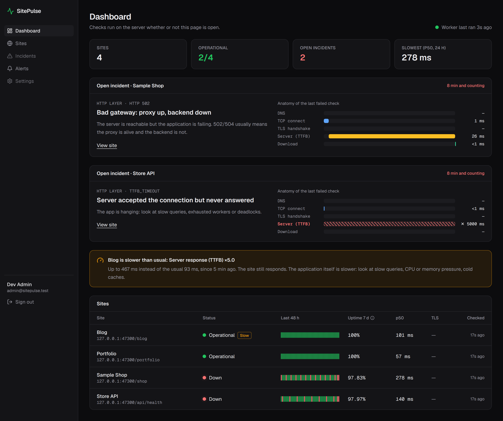
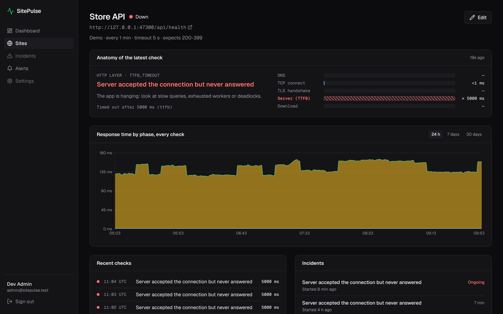
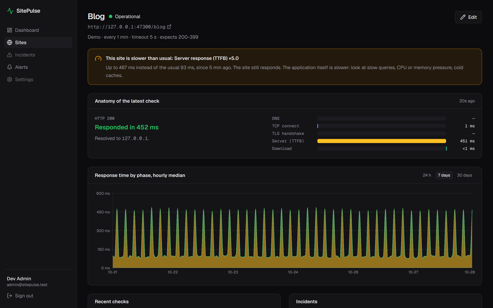
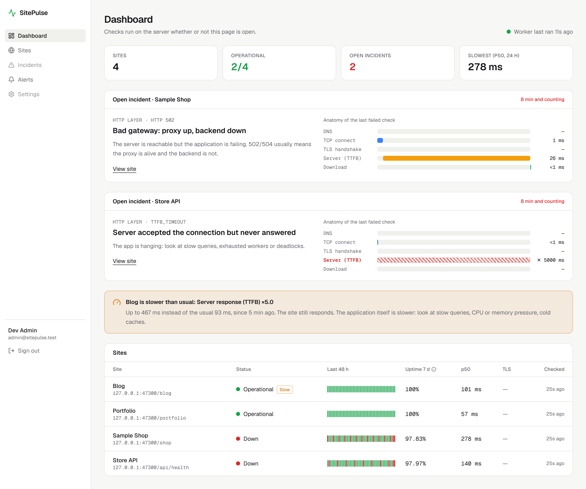
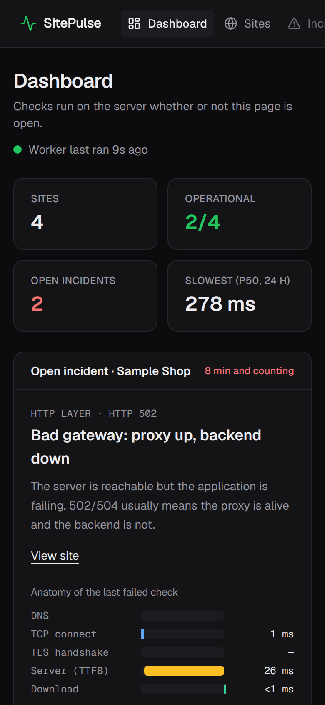
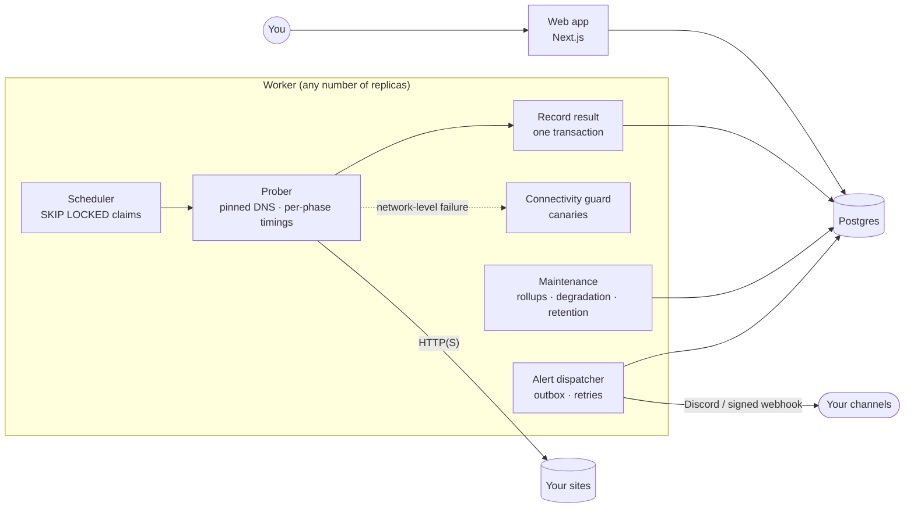

# SitePulse

**Self-hosted uptime monitoring that tells you _where_ and _why_ a site is failing, not just that it is down.**

[](https://github.com/iamyahyr/sitepulse/actions/workflows/ci.yml)
[](LICENSE)

[Español](README.es.md)



Most uptime monitors tell you a site is down and how long it took to answer. When something breaks at 3 a.m. the next question is always the same: *is it DNS, the network, the certificate, the proxy or the app?* SitePulse answers it on every check:

- **Anatomy of every request.** Each check is timed phase by phase (DNS → TCP connect → TLS handshake → server response → download) and drawn as a DevTools-style waterfall. When a request breaks, the waterfall shows where.
- **Diagnosis in plain words.** Every failure is classified and explained: *"Bad gateway: proxy up, backend down"*, *"Certificate expired"*, *"Server accepted the connection but never answered: look at slow queries, exhausted workers or deadlocks"*.
- **Early warnings before outages.** A site that is still up but whose server response time has tripled versus its own 7-day baseline gets a "slower than usual" warning that names the phase that slowed down.
- **Alerts that do not spam.** One message when an incident opens, one when it resolves, one when a site starts degrading. Discord or a signed webhook (Slack, n8n, ntfy, Zapier…). Never one per failed check.
- **Honest uptime.** Time-weighted from confirmed incidents, never "successful checks ÷ total checks", and never rounded up to 100% when there was an outage.
- **No false alarms when _you_ are the one offline.** If the monitor's own server loses its network or DNS, it notices and does not mark every site as down.

## Screenshots

| Where the request broke | A slowdown, before it becomes an outage |
| --- | --- |
|  |  |

| Light theme | Mobile |
| --- | --- |
|  |  |

<sub>Screenshots use the built-in demo sites with staged failures (a 502, a hanging API and a slowed-down blog).</sub>

## Quick start

You need a server with Docker and Docker Compose.

```bash
git clone https://github.com/iamyahyr/sitepulse.git && cd sitepulse
cp .env.example .env
# Fill in POSTGRES_PASSWORD, BETTER_AUTH_SECRET and SITEPULSE_SECRET_KEY (openssl rand -hex 32 each)
# and set APP_URL to the address you will use, e.g. https://status.example.com
docker compose up -d --build
```

Open the setup link the web app prints on start (`docker compose logs web`), create the admin account (sign-up closes right after) and add your sites. The link carries a token, so nobody who merely reaches the server first can claim it. Postgres, the worker and the web app all run from `docker-compose.yml`; the worker applies database migrations on start and the web app waits until the worker is healthy.

- **Updating:** `git pull && docker compose up -d --build`. Migrations run automatically.
- **Backups:** everything lives in the `postgres-data` volume, e.g. `docker compose exec postgres pg_dump -U sitepulse sitepulse > backup.sql`.
- **HTTPS:** put SitePulse behind your reverse proxy (Caddy, Traefik, Nginx or Dokploy's) and set `APP_URL` to the public `https://` address. Login rate limits are per client IP, read from `X-Forwarded-For` as set by proxies in `TRUSTED_PROXIES` (private ranges by default). Exposed without a proxy, that header can be forged, so publish the port only on a private network or behind one.
- **Watching the watcher:** a monitor cannot report its own death. Set `HEARTBEAT_URL` to a [healthchecks.io](https://healthchecks.io) (or similar) ping URL to be told if the worker stops.
- **Internal services:** private and loopback addresses are blocked by default. Allow specific ranges with `ALLOW_PRIVATE_CIDRS=192.168.1.0/24`.
- **Dokploy:** create a *Compose* application pointing at this repository, add the variables from `.env.example` in its Environment tab and attach your domain to the `web` service on port 3000.

Every option is documented in [`.env.example`](.env.example).

## How it works



The worker is a separate process, so checks keep running with no browser open.

1. **Scheduling.** Every 2 s the worker claims due sites with `SELECT … FOR UPDATE SKIP LOCKED` and leases them. Any number of replicas can share the table without checking a site twice, and a crashed worker's lease simply expires.
2. **Probing.** Each site is probed outside the transaction. DNS is resolved once, every address is validated and the socket is pinned to it; redirects are followed by hand and re-validated hop by hop.
3. **Recording.** The check, the site's health, the incident timeline and any alert are written in a single transaction.
4. **Confirming.** One failure makes a site *suspect* and triggers a recheck a minute later. A second consecutive failure opens an incident, backdated to the first failure. The first success resolves it.
5. **Self-connectivity guard.** Before a network-level failure (DNS, TCP, TLS or response timeout) counts against a site, the worker checks canaries (TCP to 1.1.1.1, 8.8.8.8 and 9.9.9.9, lookups of well-known names). If they fail too, the result is set aside and retried, and the dashboard says SitePulse itself is offline. Responses that prove the site answered (a 502, an expired certificate) always count.
6. **Maintenance**, every 5 minutes:
   - **Hourly rollups** per site (success count, p50/p95 total, p50 of each phase) feed the 7- and 30-day charts.
   - **Degradation detection** compares the last hour's median of each phase with the site's own 7-day baseline. It opens a warning when a phase is at least 2.5× *and* 200 ms slower, and closes it under 1.5× so it does not flap.
   - **Retention** deletes raw checks after 30 days and rollups after 400, in small batches. Incidents are kept.
7. **Alerts** are delivered from the outbox with exponential backoff, honouring `Retry-After`. Delivery is at-least-once with a stable delivery id, and the database guarantees each alert exists once.

### Webhooks

Webhook requests carry `X-SitePulse-Event` (`incident.opened`, `incident.resolved`, `site.degraded`), `X-SitePulse-Delivery` (stable across retries: use it to de-duplicate) and `X-SitePulse-Signature: t=<unix>,v1=<hex>`, the HMAC-SHA256 of `` `${t}.${rawBody}` `` with the channel's secret:

```js
import { createHmac, timingSafeEqual } from "node:crypto";

function verify(secret, rawBody, header, toleranceSec = 300) {
  const { t, v1 } = Object.fromEntries(header.split(",").map((kv) => kv.split("=")));
  if (Math.abs(Date.now() / 1000 - Number(t)) > toleranceSec) return false; // replay
  const expected = createHmac("sha256", secret).update(`${t}.${rawBody}`).digest();
  const given = Buffer.from(v1, "hex");
  return given.length === expected.length && timingSafeEqual(given, expected);
}
```

## Security

A monitor makes requests to URLs that users type in, which makes it a textbook SSRF target. The defences are layered and tested:

- **URL policy:** only `http`/`https`, no embedded credentials. Exotic IPv4 forms (`2130706433`, `0x7f.1`, `017700000001`) are normalised before checking.
- **Address policy:** only globally routable unicast addresses. Loopback, RFC 1918, link-local, CGNAT, ULA, multicast, reserved ranges, IPv4-mapped IPv6 and NAT64/6to4/Teredo prefixes are rejected; cloud metadata endpoints are blocked even if their range is allowed.
- **DNS pinning:** every answer is validated, then the connection is pinned to the validated address, so a DNS-rebinding answer cannot swap the target between check and connect. An answer that mixes public and private addresses is rejected as a whole.
- **Redirects** are followed manually (at most 5) and every hop goes through the same checks. Responses are read up to 256 KB and never stored.
- **Webhook URLs** go through the same guard, are never redirected and never send their response back to the user.
- **Secrets:** alert channel settings are encrypted at rest with AES-256-GCM; webhook secrets are shown once.
- **Accounts:** the first account needs the setup link from the server logs, and sign-up closes once it exists. Sign-in is rate limited per client IP, and the post-login redirect only accepts paths on the same site.

Found a vulnerability? See [SECURITY.md](SECURITY.md).

## Public demo

A read-only instance anyone can open without an account. Its sites are served by [`apps/flaky`](apps/flaky), a small service that fails on purpose on a fixed UTC schedule:

| Site | Scenario | What SitePulse shows |
| --- | --- | --- |
| Portfolio | Always healthy | Baseline |
| Sample Shop | 502 for 5 minutes every 4 hours | Incident, "Bad gateway: proxy up, backend down" |
| Store API | Hangs for 7 minutes every 6 hours | Incident with a server-response timeout in the waterfall |
| Blog | 5× slower for one hour every 4 hours | "Slower than usual: Server response (TTFB)", no outage |

Checks run every minute, so incidents open and close while visitors watch. On first start the worker backfills a week of history from the same schedule, pushed through the real incident state machine, so the past and the live data agree.

```bash
docker compose -f docker-compose.yml -f docker-compose.demo.yml up -d --build
```

Visitors browse as a built-in account with no password or session, every write is refused on the server, and the SSRF allowlist opens exactly one private address: the flaky service (`172.30.0.10/32`). Run it on its own database.

## SitePulse or something else?

Mature, excellent open-source monitors already exist, and for many people they are the better choice:

- **[Uptime Kuma](https://github.com/louislam/uptime-kuma)** if you want many monitor types (TCP, ping, DNS, Docker, databases…), a long list of notification integrations and status pages, all configured from a polished UI.
- **[Gatus](https://github.com/TwiN/gatus)** if you prefer monitors as code: endpoints and conditions in a YAML file you keep in Git.
- **[Upptime](https://github.com/upptime/upptime)** if you do not want to run a server at all: checks run on GitHub Actions and the status page is a GitHub Pages site.

SitePulse is deliberately narrower. It only monitors HTTP(S), and it spends its effort on explaining failures (per-phase timings, plain-language diagnosis, per-phase degradation warnings) and on being careful (confirmed incidents, time-weighted uptime, a guard against its own outages, SSRF defences).

## Limitations

Known, deliberate or not done yet:

- **HTTP(S) only.** No TCP, ping, DNS, keyword or authenticated API checks.
- **One vantage point.** Checks run from wherever the worker runs, with no multi-region confirmation. The connectivity guard avoids false alarms when that server is offline; it does not replace a second location.
- **It cannot report its own death.** If the whole server goes down, nothing inside it can alert you. Use `HEARTBEAT_URL`.
- **Detection delay.** An incident opens on the second consecutive failure, about a minute after the first. Shorter outages show up as failed checks but not as incidents.
- **TLS expiry is shown, not alerted on yet.**
- **Two alert channels:** Discord and generic webhooks. No email yet.
- **DNS through c-ares.** The prober resolves with the system's nameservers but ignores `/etc/hosts`, which is right for public sites but surprising for hosts-file-only internal names.
- **English UI.** Spanish is planned.
- **Single tenant.** Built for one person or team per instance; sign-up closes after the admin account exists.

## Roadmap

- Public status page per client
- Monthly report per client (uptime, incidents, latency), as a shareable link or PDF
- Certificate expiry alerts (30 / 14 / 7 days)
- Keyword checks and email alerts
- Spanish UI

## Development

```bash
pnpm install
docker compose -f docker-compose.dev.yml up -d   # Postgres on 127.0.0.1:5442
cp apps/web/.env.example apps/web/.env.local     # set BETTER_AUTH_SECRET and SITEPULSE_SECRET_KEY
cp apps/worker/.env.example apps/worker/.env     # same SITEPULSE_SECRET_KEY
pnpm db:migrate
pnpm dev                                         # web, worker and flaky; open the /setup link it prints
pnpm db:seed you@example.com                     # optional: demo sites + 7 days of history
pnpm test                                        # set TEST_DATABASE_URL to run the Postgres tests too
```

For the demo sites to keep checking live, run the worker with `ALLOW_PRIVATE_CIDRS=127.0.0.0/8` (they point at the flaky service on `127.0.0.1:8080`).

```text
apps/web        Next.js app: dashboard, sites, alerts, auth
apps/worker     Scheduler, prober, incidents, alert dispatcher, maintenance
apps/flaky      The deliberately unreliable service behind the demo
packages/core   Pure logic: SSRF guard, prober, diagnosis, state machine,
                uptime, degradation, notifiers, crypto (most of the tests)
packages/db     Drizzle schema and migrations
```

Stack: TypeScript, Next.js 16, React 19, Tailwind CSS 4, Recharts, Drizzle ORM, PostgreSQL 17, better-auth, Vitest, Docker. Contributions are welcome: see [CONTRIBUTING.md](CONTRIBUTING.md).

## License

[MIT](LICENSE)
